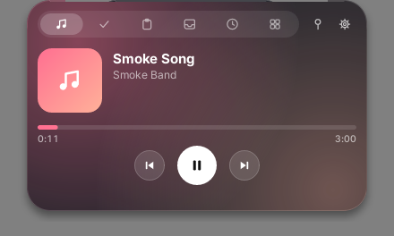
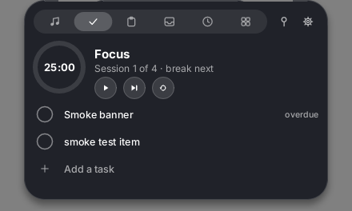
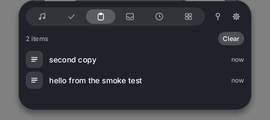

# Perch

A small "dynamic island" for the top of your desktop. A pill sits at the top
edge of the screen. Hover it and it grows into a panel with what's playing,
your to-dos, clipboard history, unread mail, a file shelf, a volume mixer and a
few tools.
Move away and it shrinks back.

Written in Rust, with no Electron, no WebView and no background polling (the
one exception is opt-in: on Windows, mirroring other apps' notifications
checks a file once a second). Idle, it uses about 30 MB of RAM and no CPU.
It runs on **Windows 10/11** and **Linux Mint Cinnamon (X11)**.



*(Screenshots come from the Linux CI smoke test: Xvfb + openbox + picom.)*

## Contents

- [Features](#features)
- [Platform support](#platform-support)
- [Install](#install)
- [Use](#use)
- [Configuration](#configuration)
- [Privacy](#privacy)
- [Performance](#performance)
- [Known limitations](#known-limitations)
- [Build from source](#build-from-source)
- [Testing](#testing)
- [Design decisions](#design-decisions)
- [License](#license)

## Features

Everything except Media and To-do is **off by default**. A feature you leave
off is never initialised, so it costs no memory, threads or wake-ups. Turn
features on from the tray menu, the settings window (`perch settings`) or the
config file.

| Feature | What it does | Default |
|---|---|---|
| **Now playing** | Track, artist, cover art, play/pause/next/previous and a seek bar. Windows: System Media Transport Controls (Spotify, browsers, Media Player...). Linux: MPRIS (Rhythmbox, Firefox, VLC, Spotify...). The collapsed pill shows the track, or the current lyric line, live, when synced lyrics are on. Drag the seek bar to jump. | on |
| **Synced lyrics** | Time-synced lyrics from [LRCLIB](https://lrclib.net) for the current track, cached on disk. Uses the network, only after you turn it on. | off |
| **Mail (read-only)** | Unread mail from your IMAP accounts (Gmail, company mail on Spacemail, Yahoo, iCloud, Fastmail, Zoho or any IMAP server): an unread count in the pill, a Mail tab with sender, subject and age, and a notification for new mail. New mail is **pushed** (IMAP IDLE), not polled. Perch opens the inbox read-only and fetches only envelopes, so it **can't mark, move, delete or download** messages. Passwords live in the system keychain (Windows Credential Manager / GNOME Keyring), never in the config file. | off |
| **Notifications from other apps** | Mirrors other apps' notifications (WhatsApp, Teams, Discord, Thunderbird...) into the notch as a half-open banner: app, sender and two lines of text. Windows: read locally through its notification access. Linux: a copy of each one sent to the desktop's notification service (D-Bus). Nothing is stored or sent. | off |
| **To-do** | A short list with optional due times, which raise a notification. | on |
| **Pomodoro** | 25/5 timer with the countdown in the collapsed pill. | off |
| **Clipboard history** | Text and images, 50 entries, in memory only. Copies that password managers mark as secret are **never read** (Windows clipboard-exclusion formats; X11 `x-kde-passwordManagerHint`). | off |
| **File shelf** | Drop files onto the panel to park them. Drag them out again on Windows; on Linux, click to copy them to the clipboard. | off |
| **Reminders** | Drink water every hour; stretch after 45 minutes of active use (idle time doesn't count). | off |
| **Volume mixer** | The system volume (kept in sync with the taskbar speaker and the volume keys) and a slider and mute button per application; drag the sliders. Windows: WASAPI. Linux: PulseAudio / PipeWire-Pulse. | off |
| **White noise** | Rain, forest and waves, generated procedurally and mixable. No audio files ship with the app. The audio device is opened only while something plays. | off |
| **Screen time** | Per-app foreground time for each day, kept for 30 days in a local SQLite file. | off |
| **Screenshot** | Drag a region, annotate it (pen, arrow, text), then copy, save or "copy text" (OCR). OCR uses Windows.Media.Ocr or `tesseract` on Linux, both offline. | off |
| **Camera mirror** | A live webcam preview in the panel. The camera is opened only while the mirror is visible. | off |
| **Dictation** | Offline speech-to-text with whisper.cpp; the text is pasted where you type. Shipped as a separate `perch-speech` build (see [limitations](#known-limitations)). On first use it downloads a model (78–488 MB, picked from your RAM and CPU) from a pinned Hugging Face revision and checks its SHA-256. | off |

Also included: a tray icon (Windows notification area / Linux
StatusNotifierItem with an XEmbed fallback), a settings window, live reload of
the config file, start-at-login, a hide-while-fullscreen option, global
hotkeys, and a command line that talks to the running instance.

Notifications (new mail, due to-dos, Pomodoro phases, reminders and, if you
turn it on, other apps' notifications) **open the notch halfway** for four
seconds with just the essentials: who, what, and two lines of text. Hover
to keep it, click it to open the matching tab. They wait while a fullscreen app is
active. System notifications are off by default and can be turned on in
settings (`[notifications] system = true`).





## Platform support

How each claim was checked:

- **verified on Windows**: run on the development machine (Windows 11 25H2) by
  the automated smoke scripts, which use real windows, real input, real SMTC
  and real OCR.
- **CI-verified (ubuntu-22.04 container)**: run by `scripts/linux-ci.sh` in
  the `docker/linux-ci.Dockerfile` image (Ubuntu 22.04, the Mint 21 base) under
  Xvfb + openbox, with and without the picom compositor. GitHub Actions runs
  the same script on `ubuntu-22.04`.
- **verified on real Mint**: still needs a run of `scripts/mint-test.sh` on a
  real Mint machine. **No row has this label yet.**
- **implemented, untested**: the code exists but nothing here exercised it.

| Area | Windows 10/11 | Linux Mint Cinnamon (X11) | Other X11 desktops | Wayland |
|---|---|---|---|---|
| Pill + hover expand/collapse, no focus stealing | verified on Windows (11; 10 untested) | CI-verified (container) | CI-verified (openbox), others untested | not implemented |
| Always on top, not in taskbar/Alt-Tab | verified on Windows | CI-verified (dock + ABOVE/STICKY/SKIP_*, survives a WM restart) | same | — |
| Transparent rounded pill | verified on Windows | rendered with picom (ARGB) and without a compositor (XShape); screenshots only, no automated pixel check | same | — |
| Hide when an app is fullscreen | verified on Windows | CI-verified (EWMH fullscreen) | same | — |
| Tray icon | verified on Windows | implemented, untested on Cinnamon (`xapp-sn-watcher`); XEmbed fallback CI-verified to start | implemented, untested | — |
| CLI → running instance | verified on Windows (named pipe) | CI-verified (Unix socket) | same | — |
| Global hotkeys | verified on Windows (RegisterHotKey) | CI-verified (XGrabKey) | same | not implemented |
| Now playing | verified on Windows (real SMTC session) | CI-verified (mock MPRIS player + playerctl) | same | would work (D-Bus) but needs the window |
| Lyrics | unit + integration tests (fake HTTP); live LRCLIB fetch not exercised by tests | same | same | — |
| To-do, Pomodoro, reminders | verified on Windows (CLI + model tests) | CI-verified | same | — |
| Notifications | implemented (toast, AppUserModelID registered per user); in-pill fallback verified | CI-verified (D-Bus notifications test) | same | — |
| Clipboard history + password-manager skip | verified on Windows | CI-verified (`xclip` + KeePassXC-style owner) | same | — |
| File shelf | drop in: model tests; drag out: implemented, untested by automation | drop in: model tests; copy as file: implemented | same | — |
| Volume mixer | verified on Windows (opt-in real-audio test: finds and controls a live stream) | CI-verified (PulseAudio null sink + `paplay`) | same | — |
| White noise | verified on Windows (opt-in real-audio test: device opens and closes) | generator tests; playback untested (no sound card in CI) | same | — |
| Screen time | verified on Windows | CI-verified | same | not implemented |
| Screenshot + annotate + copy | verified on Windows | CI-verified | same | not implemented |
| OCR | verified on Windows (Windows.Media.Ocr) | CI-verified (tesseract) | same | — |
| Camera mirror | implemented; webcam present but **not switched on** by the tests (needs your consent: `cargo test -p perch --test camera -- --ignored`) | implemented, untested | — | — |
| Dictation | builds on CI's MSVC runner only; untested here | CI-verified end-to-end (espeak-ng voice → whisper tiny → text) | same | — |
| Start at login | verified on Windows (HKCU Run) | CI-verified (XDG autostart file) | same | — |
| Multi-monitor, mixed DPI | placement logic unit-tested with fake monitors; the dev machine has one 1080p monitor | same | same | — |
| Mail (read-only) | verified on Windows against a real Dovecot server (TLS, Credential Manager, push, nothing marked read); Gmail/Spacemail themselves not signed into by the tests | CI-verified against Dovecot (TLS, STARTTLS, GNOME Keyring, push, read-only, wrong password not retried, add-account dialog typed into) | same | would work (no window) |
| Installer | verified on Windows (per-user NSIS install/uninstall, portable zip) | CI-verified (`.deb` installs and runs in a clean 22.04 container; `install.sh`) | — | — |

**Wayland:** not supported yet. On a Wayland session Perch runs through
XWayland, so the pill shows up but keep-above, hover-at-the-edge and hotkeys
depend on the compositor. Mint's default Cinnamon session is X11.

## Install

### Windows

Download `perch-<version>-windows-x64-setup.exe` and run it. It installs for
your user only (no admin) into `%LOCALAPPDATA%\Programs\Perch`, adds a
Start-menu entry and an Add/Remove Programs entry, and can start Perch when it
finishes. The uninstaller removes everything except your settings in
`%APPDATA%\perch`.

There's also `perch-<version>-windows-x64-portable.zip`: unzip it anywhere and
run `perch.exe`.

**SmartScreen:** the builds aren't code-signed, so Windows may say "Windows
protected your PC". Click *More info → Run anyway*. Each release lists its
SHA-256 checksums so you can verify the download
(`Get-FileHash .\perch-*-setup.exe`). Signing needs a paid certificate, which
this project doesn't have.

### Linux Mint / Ubuntu (22.04+, glibc 2.34+)

```bash
sudo apt install ./perch_0.1.0-1_amd64.deb
```

Then start **Perch** from the menu. The package recommends `tesseract-ocr`
(screenshot OCR) and suggests `playerctl`.

Without a package manager, use the tarball:

```bash
tar xf perch-0.1.0-linux-x86_64.tar.gz
```

```bash
perch-0.1.0-linux-x86_64/install.sh
```

That installs into `~/.local/bin` plus a menu entry and icons.
`install.sh --uninstall` removes them again.

## Use

- **Hover** the pill (or the thin strip at the top edge around it) to open the
  panel. Move away to close it. Click the pin icon to keep it open.
- **Tabs:** Music, Tasks, Clips, Shelf, Mixer, Sounds, Time, Tools. Only tabs
  for features that are on appear.
- **Tray:** turn features on and off, open settings, toggle start-at-login,
  quit.
- **Hotkeys** (change them in the config): `Ctrl+Alt+N` toggles the notch,
  `Ctrl+Alt+S` takes a screenshot, `Ctrl+Alt+D` dictates (hold to talk where
  supported).

### Command line

Each verb is sent to the running instance over a named pipe (Windows) or a
Unix socket (Linux). If Perch isn't running, the verb fails with a message
and starts nothing:

```text
perch                      start (same as `perch run`)
perch toggle-notch         open/close the panel
perch pin                  keep the panel open until pinned again
perch tab clips            open a tab: music tasks clips shelf mixer sounds time tools
perch todo "buy milk"      add a to-do
perch todo +10m Call Ann   ... due in 10 minutes (also +30s, +2h or 14:30)
perch pomodoro             start/stop the Pomodoro timer
perch play-pause | next | previous
perch shot                 screenshot
perch dictate              dictation (perch-speech build)
perch settings             settings window
perch reload               re-read the config file
perch mail-add             open the add-mail-account dialog
perch mail-retry           reconnect mail accounts (after changing a password)
perch mail-password Work   store account "Work"'s password (read from stdin) in the keychain
perch quit
perch --version | --help
```

If your desktop already owns a hotkey (Perch logs a conflict), bind these
commands to keys in your desktop's keyboard settings instead.

## Configuration

A TOML file, created with defaults on first run and reloaded live when you
save it:

- Windows: `%APPDATA%\perch\config\config.toml`
- Linux: `~/.config/perch/config.toml`

```toml
[notch]
position = "top-center"    # also top-left, top-right, bottom-*, left/right-center
monitor = 0                # omit for the primary monitor
hide_on_fullscreen = true
collapse_delay_ms = 220

[features]
media = true
lyrics = false             # network: LRCLIB
todo = true
pomodoro = false
clipboard = false
shelf = false
reminders = false
volume_mixer = false
white_noise = false
screen_time = false
screenshot = false
camera_mirror = false
speech_to_text = false     # perch-speech build; downloads a model once
mail = false               # network: your IMAP servers, read-only
notification_mirror = false  # show other apps' notifications

[notifications]
in_notch = true            # banners inside the notch
system = false             # also Windows toasts / desktop notifications

[hotkeys]
toggle_notch = "Ctrl+Alt+N"
screenshot = "Ctrl+Alt+S"
dictate = "Ctrl+Alt+D"

[mail]
notify = true              # notification when new mail arrives
notify_subject = true      # false: sender only (e.g. for shared screens)
max_items = 10             # unread messages listed per account
poll_minutes = 5           # only for servers without IMAP IDLE

[[mail.accounts]]          # added for you by "Add mail account…" in settings
name = "Work"
username = "you@yourcompany.com"
host = "mail.spacemail.com"
port = 993
security = "tls"           # tls (993), starttls (143), plain (localhost only)
folder = "INBOX"
ca_file = ""               # PEM of a private CA, for self-hosted servers
```

### Adding a mail account

Turn on **Mail (read-only)** in settings, then click **Add mail account…**.
Pick the provider (Spacemail, Gmail, Yahoo, iCloud, Fastmail, Zoho or
Other), type your address and password, and click **Add account**. Perch saves
the password to the system keychain and the rest to the config. The Mail tab
then shows "connecting…" and, a moment later, your unread mail. If sign-in
fails, the tab says so and Perch **stops trying**, so a wrong password can't
get your account locked. Fix the password with **Remove** and add the account
again, or with `perch mail-password <name>` followed by `perch mail-retry`.

- **Gmail / Google Workspace:** use an *app password* (Google Account →
  Security → 2-Step Verification → App passwords). Your normal password won't
  work over IMAP.
- **Spacemail (Namecheap):** your mailbox password; server
  `mail.spacemail.com`, port 993.
- **Microsoft 365 / Outlook.com:** not supported yet. Microsoft only allows
  OAuth sign-in for IMAP; see the limitations.

The settings window covers the common options and has a button that opens
this file. Data lives next to it: `%APPDATA%\perch\data` on Windows,
`~/.local/share/perch` on Linux. That folder holds to-dos, shelf entries,
`usage.sqlite` for screen time, the lyrics cache and the dictation model.

## Privacy

- Everything stays on your machine. No telemetry, accounts, analytics or ads.
- Only three features touch the network, and only after you turn them on:
  **lyrics** (one request to `lrclib.net` per new track; the result is
  cached), **dictation** (a one-time model download from Hugging Face, checked
  by SHA-256), and **mail** (a TLS connection to each mail server *you* add,
  nothing else). The settings window marks which features use the network.
- Mail is read-only by construction: Perch opens the folder with `EXAMINE` and
  fetches only `UID INTERNALDATE ENVELOPE` for unread messages, never message
  bodies. Passwords are stored only in the system keychain; the config file
  holds the server and username. Unencrypted IMAP is refused except to
  `localhost`.
- Clipboard history is kept in memory only and cleared when you turn the
  feature off. Copies flagged by password managers are skipped before their
  content is read.
- Screenshots go only to the clipboard, or to `Pictures/Perch` if you click
  Save. OCR runs locally.
- The camera and microphone are opened only while the mirror is visible or
  dictation is recording.
- Notifications from other apps (off by default) are read locally: on Windows
  through its notification access (Settings > Privacy & security >
  Notifications), on Linux as a copy of each `Notify` call on your session
  bus. They are held in memory only for the banner and never stored, logged
  or sent. Turn the feature off and the reader stops.

## Performance

Targets from the brief: idle RAM < 40 MB, idle CPU ≈ 0 %, cold start
< 300 ms, binary < 15 MB. Windows and Linux numbers come from different
machines and environments, so they're listed separately.

### Windows 11 (Ryzen 7 3800X, RX 6600, one monitor at 1920×1080)

| Metric | Result | Source |
|---|---|---|
| Cold start (process start → first frame on screen) | 85 ms (84–109 ms over all runs) | `smoke-windows.ps1`; the app's own timer |
| Idle private memory, default features | 24–26.5 MB (after opening every tab) | smoke test |
| Idle private memory, 7 features on (media, to-do, Pomodoro, clipboard, shelf, reminders, screen time) | ~25–31 MB | 10- and 30-min soaks |
| Render time, settled Music panel | 1.9 ms at 1×, 6.5 ms at 2× (budget 4 / 8 ms) | `tests/budget.rs`, release |
| Idle CPU | 0 % (median 10 s interval ≤ 1 timer tick) | soak |
| 30-min soak, leak check (machine in use) | PASS: private bytes −0.1 MB, handles +14, GDI/USER flat | `soak-windows.ps1` |
| 10-min soak after the Glass UI | PASS: private bytes +0.01 MB, handles −2, GDI/USER flat, CPU at rest 0 % | `soak-windows.ps1 -Minutes 10` |
| Idle private memory, mail on (one account, signed in, idling) | 25.2 MB | `mail-test-windows.ps1` |
| `perch.exe` size (all default features) | 8.8 MB (fonts subset; mail adds 0.35 MB) | release build, GNU toolchain |
| Installer / portable zip | 3.5 MB / 4.3 MB | `package-windows.ps1` |

### Linux (ubuntu-22.04 container: Xvfb + openbox, 8 vCPUs on the same host)

| Metric | Result | Source |
|---|---|---|
| Cold start (first frame) | 61–86 ms | `smoke-x11.sh` |
| Idle RSS after the full smoke run (7 features, every tab opened, screenshot used) | ~36 MB | smoke test |
| Idle RSS, 7 everyday features | ~34 MB | 30-min soak |
| Idle CPU | 0 ticks in 10 s | smoke test + soak |
| 30-min soak, leak check | PASS: RSS +1.1 MB, fds flat, CPU at rest 0 % | `soak-linux.sh` |
| Idle RSS, mail on (three accounts signed in; an emoji subject loads the symbols font) | ~41 MB | `mail-test.sh` |
| `perch` binary size / `.deb` | 12.5 MB / 4.5 MB | release build, `cargo deb` |
| glibc required | 2.34 | `objdump -T` |

Numbers from real Mint hardware will come from `scripts/mint-test.sh`, which
writes `artifacts/mint/mint-results.md`.

## Known limitations

- **Wayland isn't implemented.** There's no layer-shell window, portal
  screenshots or GlobalShortcuts portal yet. Use an X11 session.
- **Dictation on Windows needs the MSVC toolchain.** whisper.cpp's build passes
  an MSVC-only flag to MinGW, and the dev machine has no admin rights for MSVC,
  so `perch-speech.exe` is built only by GitHub Actions (`windows-latest`,
  MSVC) and wasn't run here. On Linux, dictation is tested end to end.
- **Not tested on a real Mint machine yet.** All Linux results come from the
  Ubuntu 22.04 container. Run `scripts/mint-test.sh` to get real numbers.
- **Multi-monitor and HiDPI** are covered by unit tests with fake monitors
  only (the dev machine has one 1080p screen). On X11, Perch follows Xft.dpi
  and Cinnamon's scaling factor.
- **Linux shelf drag-out** isn't supported: click an item to copy it as a file
  and paste it in your file manager.
- **Windows volume mixer** follows the output device that was default when the
  feature started. After switching the default device, toggle the mixer off
  and on.
- **Windows 10** isn't tested. The APIs used exist there, but the
  fullscreen/overlay heuristics were tuned on Windows 11.
- **Unsigned builds**: see SmartScreen above.
- **Camera mirror** wasn't run against the webcam, because that would turn the
  camera on without the owner present.
- **Mail: no OAuth.** Accounts that only allow OAuth sign-in (Microsoft 365,
  Outlook.com, and Google accounts without app passwords) don't work yet.
  Password and app-password sign-in over TLS/STARTTLS does. OAuth needs an
  app registered with each provider, which this project doesn't have.
- **Mail: folder names must be ASCII** (e.g. `INBOX`, `Work`), since modified
  UTF-7 names aren't encoded yet.
- **Mail: certificates.** Servers need a certificate from a public CA, or a
  private CA given in `ca_file`. A bare self-signed certificate is refused,
  as it should be.
- **Mail on Linux without a keyring:** with no Secret Service running, a
  password is kept only until Perch exits. Cinnamon runs GNOME Keyring by
  default.
- **Mail with real providers** (your Gmail, your Spacemail mailbox) is tested
  only by you: the automated tests use a local Dovecot server and never sign
  into real accounts.

## Build from source

Rust 1.85 or newer.

**Windows** (MSVC or GNU toolchain):

```bash
cargo build --release -p perch
```

Building the installer needs [NSIS](https://nsis.sourceforge.io)
(`makensis` on PATH, or `~/tools/nsis`):

```bash
powershell -File scripts/package-windows.ps1
```

Dictation build (MSVC + LLVM/libclang + CMake):

```bash
cargo build --release -p perch --features speech
```

**Linux Mint / Ubuntu:**

```bash
./scripts/mint-setup.sh --with-optional
```

```bash
cargo build --release -p perch
```

```bash
cargo install cargo-deb && cargo deb -p perch
```

**Linux from Windows** (what this project uses for Linux verification):

```bash
docker build -t perch-linux-ci -f docker/linux-ci.Dockerfile docker
```

```bash
docker run --rm -v "$PWD:/src" -v perch-target:/target perch-linux-ci scripts/linux-ci.sh all
```

### Layout

```text
crates/core               platform-independent logic: config, notch state machine,
                          media/lyrics, to-do, Pomodoro, reminders, clipboard, usage, hotkeys
crates/platform-windows   Win32/WinRT: window styles, SMTC, WASAPI, clipboard, OCR, IPC...
crates/platform-linux     X11 (x11rb), MPRIS/notifications (zbus), PulseAudio, tray (ksni)
crates/ui                 winit + softbuffer + tiny-skia renderer, panel, settings, screenshot overlay
crates/app                the `perch` binary: model (state -> effects), shell, CLI, features
packaging/                NSIS script, .desktop file, install.sh
scripts/                  smoke, soak, CI and Mint test scripts
```

## Testing

See [TESTING.md](TESTING.md) for every command that was run and its result.
In short:

```bash
cargo test --workspace
```

```bash
powershell -File scripts/smoke-windows.ps1
```

```bash
./scripts/mint-test.sh
```

The first is the unit, integration and property tests. The second is the
Windows end-to-end smoke test (it moves the mouse; leave the machine alone).
The third is the real Linux Mint run, about 40 minutes.

## Design decisions

The reasoning behind each choice is in [docs/DECISIONS.md](docs/DECISIONS.md).
The main ones:

- **winit + softbuffer + tiny-skia + fontdue** instead of Slint, egui or GTK:
  the smallest binary and memory footprint of the options measured, and full
  control over the per-OS window shells (ADR-001).
- **Event-driven only:** OS callbacks (WinEvent hooks, SMTC events, D-Bus
  signals, X11 events) feed winit's event loop through an `EventLoopProxy`.
  Timers are deadlines (`ControlFlow::WaitUntil`). No tokio, no polling
  (ADR-002, ADR-006), except the opt-in notification mirror, which checks the
  notification store's timestamp once a second because Windows gives
  unpackaged apps no change event (ADR-020).
- **GNU toolchain on Windows** for local builds, because no admin rights means
  no MSVC; CI builds both (ADR-003).
- **Linux verified in an Ubuntu 22.04 container** that runs the same script as
  CI (ADR-005).
- **NSIS per-user installer**, no admin needed (ADR-008).
- **Heavy features are optional twice over:** cargo features at build time,
  and off by default at run time (ADR-010).
- **Glass UI from cached primitives:** tokens, Inter with a DejaVu fallback,
  vector icons, nine-slice shadows and spring motion that sleeps when
  settled. Notifications appear as banners inside the notch. The render
  budget (≤ 4 ms at 1×, ≤ 8 ms at 2×) is checked by a test (ADR-019).
- **No acrylic blur (yet):** on Windows 11 the backdrop can't be confined
  to the rounded shape of a per-pixel-transparent window (ADR-018).
- **Other apps' notifications:** on Linux a D-Bus monitor sees each `Notify`
  call as it happens. On Windows, which gives unpackaged apps no change event,
  an opt-in worker checks the store's timestamp once a second and reads the
  list only when it changed (ADR-020).
- **Unsafe code** only in thin OS wrappers, each block with a `// SAFETY:`
  comment. `#![forbid(unsafe_code)]` everywhere else.

## License

Dual-licensed under [MIT](LICENSE-MIT) or [Apache-2.0](LICENSE-APACHE), at your
option. The Perch name and bird icon are original to this project.
